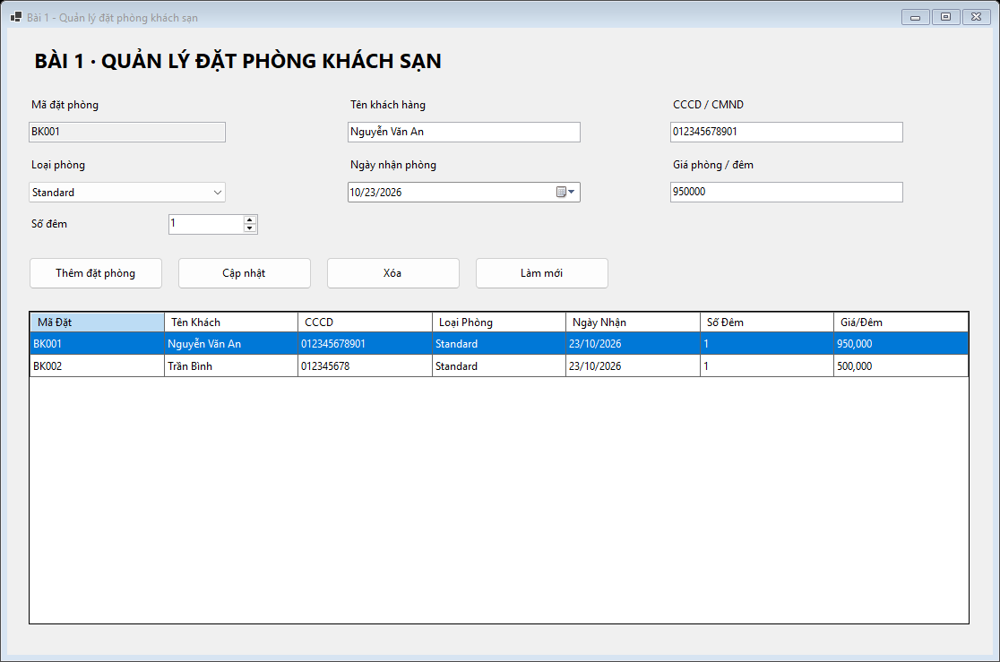
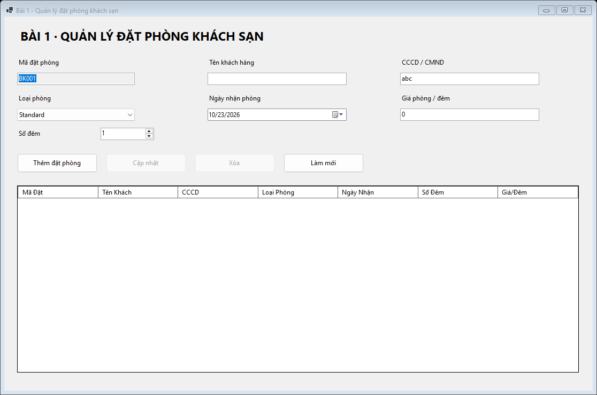
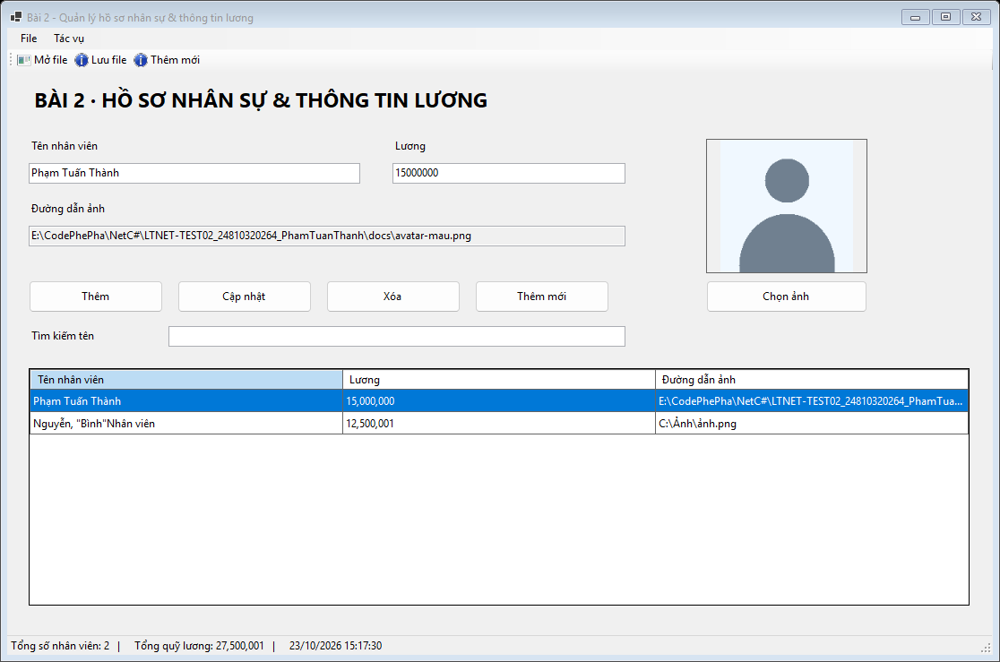
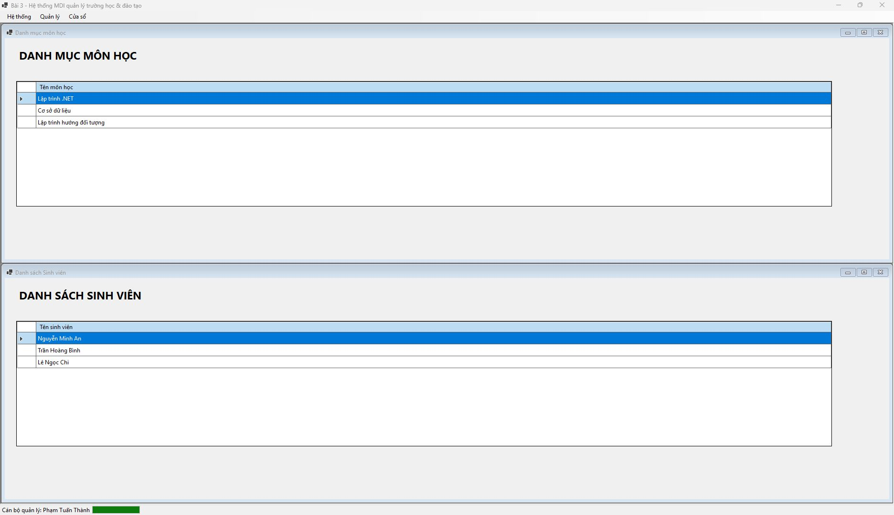
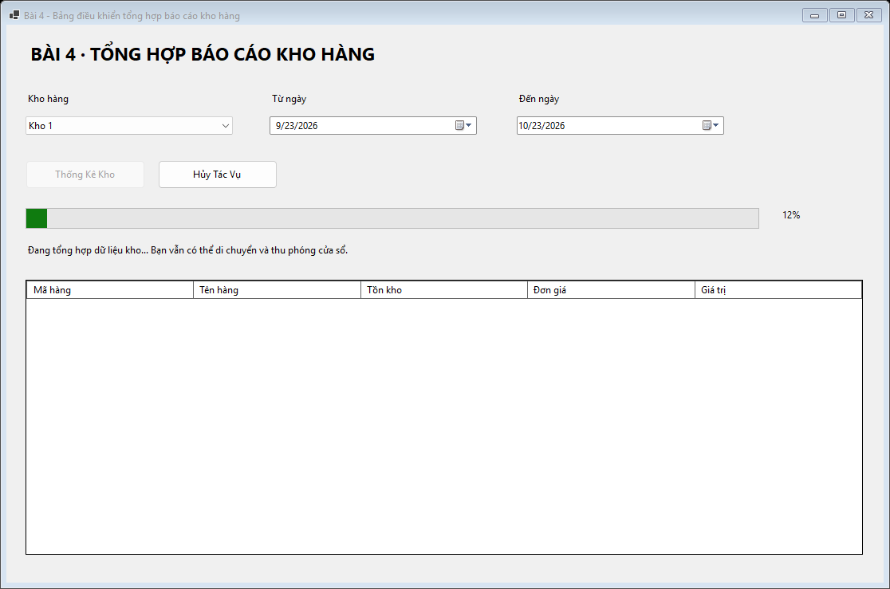
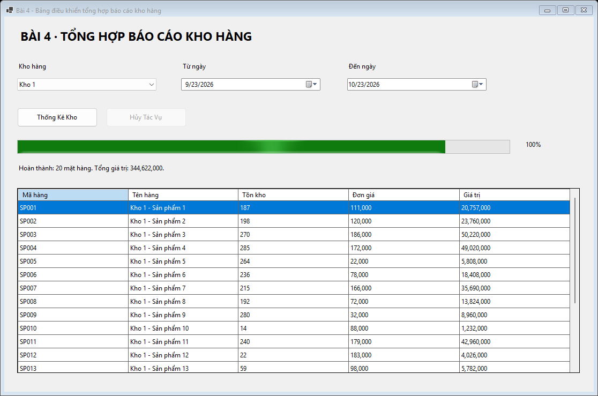
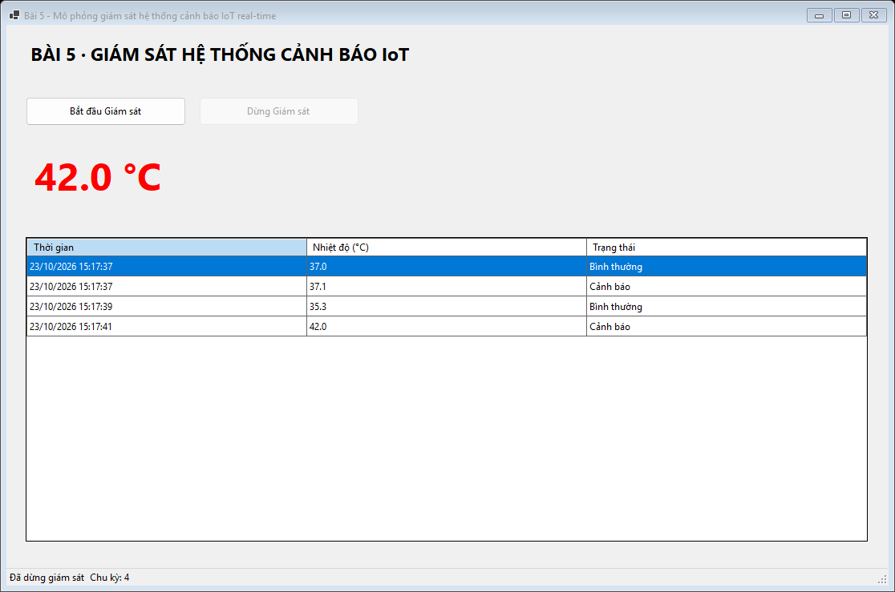

# BÁO CÁO BÀI TẬP THỰC HÀNH LẬP TRÌNH C# WINFORMS

## I. THÔNG TIN SINH VIÊN

* **Họ và tên:** Phạm Tuấn Thành
* **Mã số sinh viên:** 24810320264
* **Lớp học phần:** D19QTANM1
* **Link Repository:** https://github.com/phmthnh/LTNET-TEST02_24810320264_PhamTuanThanh
* **Đề:** D19QTANM1-LTNET-TEST02-02, TEST 02, gồm 5 bài.

---

## II. DANH SÁCH BÀI TẬP HOÀN THÀNH & TỰ ĐÁNH GIÁ

| Bài tập | Tiêu đề bài tập theo đề | Trạng thái | Mức độ hoàn thành (%) |
| :---: | :--- | :--- | :---: |
| **Bài 1** | Quản lý đặt phòng khách sạn | Hoàn thành | 100% |
| **Bài 2** | Quản lý hồ sơ nhân sự & thông tin lương | Hoàn thành với các trường tối thiểu theo nội dung đề | 100% |
| **Bài 3** | Hệ thống MDI quản lý trường học & đào tạo | Hoàn thành kỹ thuật MDI; nghiệp vụ chưa được đề mô tả không tự bổ sung | 70% |
| **Bài 4** | Bảng điều khiển tổng hợp báo cáo kho hàng | Hoàn thành | 100% |
| **Bài 5** | Mô phỏng giám sát hệ thống cảnh báo IoT real-time | Hoàn thành | 100% |

Đây là tự đánh giá, không phải điểm chấm. Tên bài lấy từ phần yêu cầu chính; không dùng các tên Gym/Nhà sách/Bệnh viện bị lệch trong ví dụ README cuối đề.

### Phạm vi đúng theo đặc tả

- Không thêm SQL/database, màn hình đăng nhập, tài khoản mẫu, chức vụ, phòng ban, mã nhân viên hoặc các quy tắc nhân sự mà đề không nêu.
- Bài 2 dùng tên nhân viên để biểu diễn thông tin nhân viên và phục vụ menu Tìm kiếm, cùng lương và đường dẫn ảnh. CSV gồm `FullName,Salary,AvatarPath`. Đề không liệt kê schema chi tiết cho `EmployeeModel`; đây là các trường tối thiểu triển khai, không khẳng định đề đã đặt tên chúng.
- Bài 3 giữ hai Form con được chỉ định: `frmStudentList`, `frmCourseList`. Hai danh sách dùng trường tối thiểu Tên sinh viên và Tên môn học. Chưa có nghiệp vụ thêm/sửa/xóa hồ sơ. Dữ liệu trong ảnh là dữ liệu minh họa theo yêu cầu, chỉ nạp trong phiên chụp và lưu local; ứng dụng chính không tự nạp sẵn dữ liệu này.
- Menu Sinh viên mở `frmStudentList`. Có lối mở **Danh mục môn học** cho `frmCourseList` vì phần cấu trúc Form yêu cầu Form này, dù danh sách menu của đề bỏ sót mục môn học. Các mục Giảng viên, Lớp học và Đổi mật khẩu giữ đúng tên, khi chọn giải thích rằng đề chưa cung cấp luồng/dữ liệu; chưa thực hiện nghiệp vụ giả định.
- Đăng xuất và Thoát đóng cửa sổ quản lý trường học, quay về màn hình chọn bài; không giả lập tài khoản hay phiên đăng nhập.
- Dữ liệu đặt phòng/nhân sự chỉ ở bộ nhớ khi Form còn mở. Nhân sự có thể lưu và mở lại qua CSV. Kho và IoT là dữ liệu mô phỏng theo yêu cầu.

---

## III. MINH HỌA GIAO DIỆN & KỸ THUẬT NỔI BẬT

### 1. Bài 1: Quản lý đặt phòng khách sạn

**Form:** `frmBookingManager`.

**Kỹ thuật:** khai báo 7 cột bằng C#, `AutoGenerateColumns = false`, `DataPropertyName`, `BindingList<BookingModel>`, `BindingSource`, `INotifyPropertyChanged`, `ErrorProvider`. Grid chỉ đọc, chọn cả dòng, giá định dạng `N0`.

**Luồng:** Làm mới → nhập dữ liệu → Thêm đặt phòng. Chọn dòng → dữ liệu lên editor → sửa → Cập nhật. Xóa yêu cầu xác nhận Yes/No với biểu tượng cảnh báo. Mã tự tăng BK001, BK002... trong phiên, không tái sử dụng mã vừa xóa.

**Validation:** tên không trống, CCCD/CMND đúng 9 hoặc 12 chữ số, giá là số lớn hơn 0. CCCD lưu chuỗi để giữ số 0 đầu. Chỉnh sửa chưa bấm Cập nhật không làm thay đổi dữ liệu đã lưu.





### 2. Bài 2: Quản lý hồ sơ nhân sự & thông tin lương

**Form:** `frmEmployeeManager`.

**Kỹ thuật:** MenuStrip, ToolStrip có biểu tượng mở/lưu/thêm, StatusStrip tổng nhân viên/quỹ lương/đồng hồ, `OpenFileDialog`, `SaveFileDialog`, PictureBox `Zoom`, CSV UTF-8.

**Luồng:** Thêm mới → nhập tên, lương → Chọn ảnh JPG/PNG → Thêm. Chọn dòng để xem ảnh, sửa hoặc xóa. Tìm kiếm theo tên; tổng nhân viên và quỹ lương vẫn tính toàn bộ danh sách. Mở CSV thay toàn bộ danh sách sau khi parse thành công; CSV lỗi giữ nguyên dữ liệu cũ. Lưu CSV xuất toàn bộ danh sách, kể cả khi đang tìm kiếm.

Ảnh được sao chép vào bộ nhớ để không khóa file gốc. CSV chỉ lưu đường dẫn, không lưu dữ liệu nhị phân ảnh. Đường dẫn ảnh tương đối được giải theo thư mục chứa CSV. Ảnh bị mất không làm ứng dụng dừng.




CSV hỗ trợ dấu phẩy, dấu ngoặc kép và xuống dòng trong trường được bao bằng dấu ngoặc kép; lương trong CSV dùng dấu chấm thập phân bất kể thiết lập vùng Windows.

### 3. Bài 3: Hệ thống MDI quản lý trường học & đào tạo

**Form:** `frmSchoolMain`, `frmStudentList`, `frmCourseList`.

**Kỹ thuật:** `IsMdiContainer = true`; tìm Form trong `MdiChildren` trước khi tạo; Form đã mở được khôi phục nếu thu nhỏ và gọi `Activate()`; Form mới được gán `MdiParent` và `Show()`. Menu Cửa sổ thực hiện `Cascade`, `TileHorizontal`, `TileVertical`, Đóng tất cả. StatusStrip hiển thị cán bộ quản lý và `ToolStripProgressBar`.



*Mô tả: Hai Form con xếp ngang, mỗi danh sách có 3 dòng dữ liệu minh họa được nạp trong phiên chụp ảnh.*

Phạm vi chưa có đặc tả được ghi ở phần II, không tự coi các menu giải thích phạm vi là chức năng quản lý hồ sơ hoàn chỉnh.

### 4. Bài 4: Bảng điều khiển tổng hợp báo cáo kho hàng

**Form:** `frmWarehouseAnalytics`.

**Kỹ thuật:** `await Task.Run(...)`, `CancellationTokenSource`, `IProgress<int>`. Tác vụ mô phỏng 50 bước × 90 ms, khoảng 4,5 giây; xử lý ngoài UI thread. `pgbStatus` và `lblPercent` cập nhật trong lúc chạy. Tiêu chí được chụp tại lúc bắt đầu để không đọc Control từ thread nền.

**Luồng:** chọn kho/khoảng thời gian → Thống Kê Kho → tiến độ → kết quả tồn kho/giá trị. Hủy Tác Vụ ngắt tác vụ nền, reset về 0%, báo đã hủy và cho phép chạy lại. Đóng Form lúc chạy cũng hủy và chờ tác vụ kết thúc an toàn. Không tạo nhiều lượt chạy chồng nhau.





Tên `bai3_async.png` được giữ để khớp ví dụ đường dẫn ảnh trong mẫu README; nội dung là Bài 4 theo đề chính.

### 5. Bài 5: Mô phỏng giám sát hệ thống cảnh báo IoT real-time

**Form:** `frmIoTMonitor`.

**Kỹ thuật:** vòng lặp `Task.Run`, chu kỳ `Task.Delay(2000, token)`, nhiệt độ ngẫu nhiên 30–42°C. Kiểm tra `InvokeRequired`, gọi `Invoke(new Action(...))` trước khi cập nhật label, grid và bộ đếm. Bật `Control.CheckForIllegalCrossThreadCalls = true` khi chạy.

**Luồng:** Bắt đầu Giám sát → mỗi 2 giây nhận nhiệt độ → cập nhật label/nhật ký/số chu kỳ → Dừng Giám sát. Trên 37°C màu đỏ; đúng 37°C và thấp hơn màu xanh. Dừng không xóa nhật ký. Đóng Form dừng vòng lặp, không truy cập Control đã giải phóng.



---

## IV. HƯỚNG DẪN CÀI ĐẶT & CHẠY DỰ ÁN

### 1. Môi trường

- Windows, Visual Studio 2022 từ 17.8 trở lên hoặc Visual Studio 2026.
- Workload **.NET desktop development**, .NET 8 SDK và Windows Desktop Runtime 8.
- Dự án target `net8.0-windows`, không cần package NuGet bên thứ ba hay database.

### 2. Clone và chạy bằng Visual Studio

```bash
git clone https://github.com/phmthnh/LTNET-TEST02_24810320264_PhamTuanThanh.git
```

1. Mở `src/WinFormsAppSolution.sln`.
2. Chọn `WinFormsApp` làm Startup Project nếu cần.
3. Chọn Debug / Any CPU, nhấn **F5**.
4. Chọn bài ở màn hình chính.
5. Xem Designer: Solution Explorer → Forms → nhấp phải `frmBookingManager.cs` (hoặc Form khác) → **View Designer**, hoặc **Shift+F7**. Mỗi Form có `.Designer.cs` riêng; không chọn `.Designer.cs` để mở Designer.

### 3. Cấu trúc thư mục

```text
LTNET-TEST02_24810320264_PhamTuanThanh/
├── .gitignore
├── README.md
├── docs/                         # Ảnh minh họa báo cáo
└── src/
    ├── WinFormsAppSolution.sln
    └── WinFormsApp/
        ├── Forms/                # 8 Form và các file Designer tương ứng
        ├── Models.cs
        ├── Services.cs
        ├── Ui.cs
        ├── Program.cs
        └── WinFormsApp.csproj
```

`.gitignore` loại bỏ `.vs/`, `bin/`, `obj/`, `*.user`, `*.suo` và các file log.
