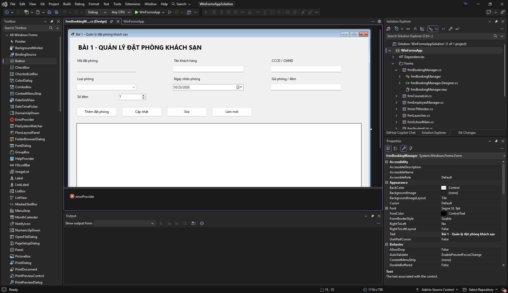
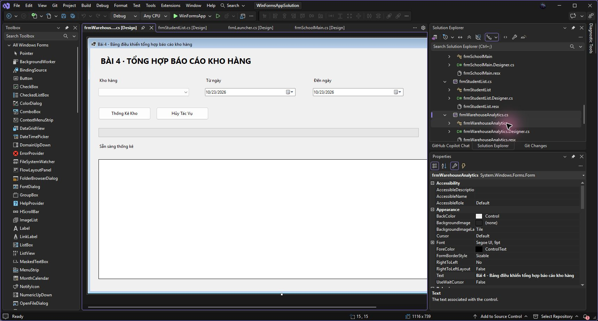
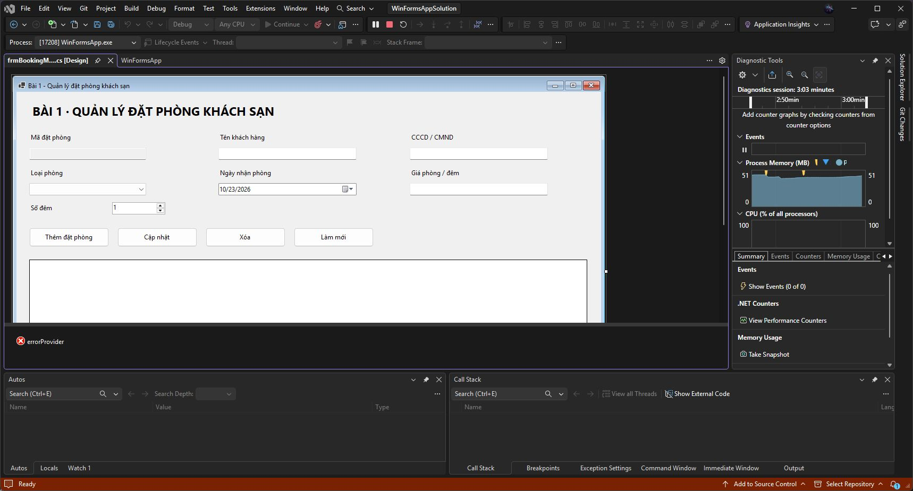
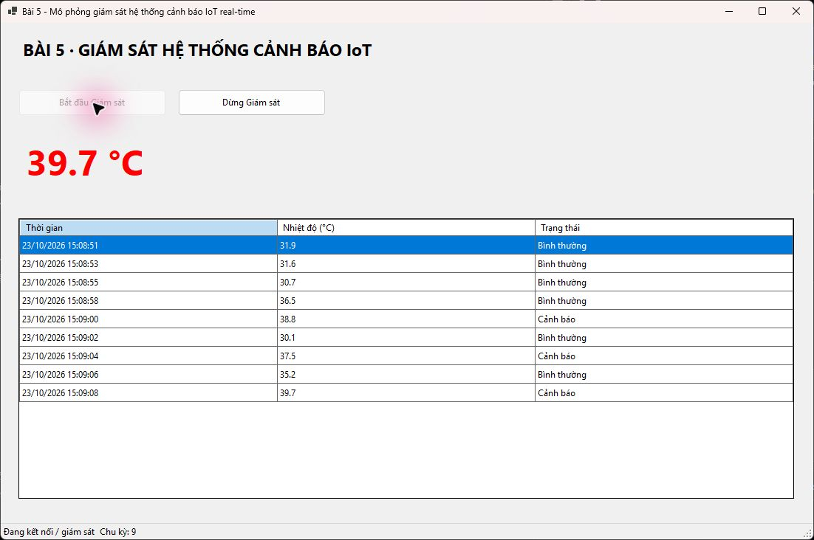

# Báo cáo kiểm thử TEST02

- Ngày kiểm thử: 23/10/2026.
- Sinh viên: Phạm Tuấn Thành, 24810320264, D19QTANM1.
- Môi trường: Windows, .NET SDK 10.0.401, target .NET 8 Windows Forms; Visual Studio 2026 Community đã cài trên máy.
- Debug build: **0 lỗi, 0 cảnh báo**.
- Release build: **0 lỗi, 0 cảnh báo**.
- Kiểm thử tích hợp: **52 kiểm tra đạt, không có lỗi**. Danh sách từng kiểm tra nằm trong [test-results.json](test-results.json).

## Phạm vi kiểm thử tự động

| Nhóm | Kiểm tra |
| --- | --- |
| Đặt phòng | CCCD 9/12 chữ số, giữ số 0 đầu, độ dài sai/chữ/chữ số Unicode; giá 0/âm/chữ; 7 cột Grid; ErrorProvider ba lỗi; thêm BK001/BK002; chưa cập nhật không thay model; cập nhật đồng thời tên và giá; chọn dòng; thông báo thay đổi model; xóa No/Yes; không tái sử dụng mã đã xóa |
| Nhân sự | CSV UTF-8, dấu phẩy, dấu ngoặc kép, xuống dòng, số thập phân, đường dẫn; import; ảnh tương đối theo thư mục CSV; không khóa file ảnh; tìm kiếm; thêm/sửa/xóa; StatusStrip; CSV lỗi giữ nguyên danh sách; CSV rỗng có header |
| MDI | Hai Form con, chống mở trùng, khôi phục Form con thu nhỏ, Cascade/TileHorizontal/TileVertical, đóng tất cả, mở lại sau đóng |
| Thống kê kho | Chống chạy chồng, tiến độ giữa chừng, thời gian xử lý, UI timer vẫn chạy, kết quả 100%, hủy về 0%, chạy lại sau hủy, đóng Form khi đang chạy |
| IoT | Ngưỡng 37°C xanh và trên 37°C đỏ, chống chạy chồng, chu kỳ 2 giây, khoảng 30–42°C, cập nhật từ worker với kiểm tra cross-thread bật, dừng không nhận thêm, đóng Form dừng worker |

Các kiểm tra chạy trên Form thật với STA thread và message loop, không chỉ kiểm tra hàm nghiệp vụ. Nhánh xác nhận xóa đặt phòng được kiểm tra bằng cách truyền kết quả No/Yes vào cùng hàm xóa mà nút Xóa gọi; không tự động bấm hộp thoại Windows. Nút Xóa thực tế dùng MessageBox Yes/No và MessageBoxIcon.Warning.

## Kiểm tra trực tiếp bằng Visual Studio

Đã mở solution `src/WinFormsAppSolution.sln` trong Visual Studio và mở Design View của cả 8 Form:

| Form | Design View |
| --- | --- |
| frmLauncher | Đã hiển thị |
| frmBookingManager | Đã hiển thị |
| frmEmployeeManager | Đã hiển thị |
| frmSchoolMain | Đã hiển thị |
| frmStudentList | Đã hiển thị |
| frmCourseList | Đã hiển thị |
| frmWarehouseAnalytics | Đã hiển thị |
| frmIoTMonitor | Đã hiển thị |

Đã nhấn F5 từ Visual Studio, mở ứng dụng, mở IoT, bấm Bắt đầu Giám sát, quan sát nhiều chu kỳ và bấm Dừng Giám sát. Không xuất hiện ngoại lệ cross-thread trong lượt chạy này. Không khẳng định mọi trường hợp đã được thao tác thủ công trong IDE; các nhóm còn lại được kiểm tra tích hợp như bảng trên.









## Các lỗi đã phát hiện và sửa

1. Ghi nhiều binding liên tiếp có thể refresh editor giữa chừng và làm mất giá vừa nhập. Đã chặn ListChanged trong lúc commit toàn bộ binding rồi refresh một lần.
2. Import danh sách vào BindingSource có thể đọc Current khi Position = -1. Đã kiểm tra vị trí và tạo danh sách hiển thị theo kết quả tìm kiếm.
3. Hộp thoại Mở CSV cần bắt InvalidDataException để báo lỗi dữ liệu thay vì để ngoại lệ thoát ra UI.
4. Đường dẫn ảnh tương đối cần được giải theo thư mục chứa CSV, không theo thư mục chạy chương trình.
5. Menu/toolbar/status items ban đầu tạo khi chạy; đã chuyển phần khai báo sang Designer để hiển thị trong Design View.

## Giới hạn đặc tả

Các mục Giảng viên, Lớp học, Đổi mật khẩu trong đề chưa có cấu trúc dữ liệu hoặc luồng xử lý; không tự triển khai nghiệp vụ giả định. Hai Form con MDI không có các trường hồ sơ/CRUD tự đặt. Phần này được đánh giá riêng trong README, không tính là đã hoàn thành nghiệp vụ quản lý hồ sơ.

Đề không yêu cầu lưu database. Đóng Form đặt phòng mất danh sách trong bộ nhớ; nhân sự cần xuất CSV để lưu lại. Ảnh CSV là đường dẫn, nên cần mang theo file ảnh nếu chuyển sang máy khác.

## Chạy lại

```powershell
dotnet build src/WinFormsAppSolution.sln -c Debug
dotnet build src/WinFormsAppSolution.sln -c Release
dotnet run --project src/WinFormsApp -- --self-test docs
```

Kiểm thử sẽ tạo lại ảnh và file CSV thử trong `docs/`, và trả exit code khác 0 nếu có lỗi. `bin/`, `obj/`, `.vs/`, file user không đưa vào Git.
